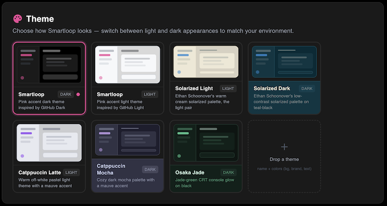

# Customizing Theme

Smartloop lets you bring your own theme and customize the look and feel of the app. A collection of open source themes is available in the [studio-themes](https://github.com/smartloop-ai/studio-themes) repository.



## Available Themes

| Name | Mode | Description |
|------|------|-------------|
| Smartloop | <span style={{border:'1px solid var(--ifm-color-emphasis-500)',color:'var(--ifm-color-content)',background:'transparent',padding:'1px 6px',fontWeight:'bold',fontSize:'11px'}} >dark</span> <span style={{border:'1px solid #ec4899',color:'#ec4899',background:'transparent',padding:'1px 6px',fontWeight:'bold',fontSize:'11px'}} >light</span> | Default theme with a pink accent |
| Solarized | <span style={{border:'1px solid var(--ifm-color-emphasis-500)',color:'var(--ifm-color-content)',background:'transparent',padding:'1px 6px',fontWeight:'bold',fontSize:'11px'}} >dark</span> <span style={{border:'1px solid #ec4899',color:'#ec4899',background:'transparent',padding:'1px 6px',fontWeight:'bold',fontSize:'11px'}} >light</span> | Ethan Schoonover's classic low-contrast palette |
| Catppuccin Latte | <span style={{border:'1px solid #ec4899',color:'#ec4899',background:'transparent',padding:'1px 6px',fontWeight:'bold',fontSize:'11px'}} >light</span> | Warm pastel light theme with a mauve accent |
| Catppuccin Mocha | <span style={{border:'1px solid var(--ifm-color-emphasis-500)',color:'var(--ifm-color-content)',background:'transparent',padding:'1px 6px',fontWeight:'bold',fontSize:'11px'}} >dark</span> | Cozy dark mocha palette with a mauve accent |
| Osaka Jade | <span style={{border:'1px solid var(--ifm-color-emphasis-500)',color:'var(--ifm-color-content)',background:'transparent',padding:'1px 6px',fontWeight:'bold',fontSize:'11px'}} >dark</span> | Jade-green CRT console glow on black |


## Installing a Custom Theme

1. Download the `.yaml` file you want from the [studio-themes](https://github.com/smartloop-ai/studio-themes/blob/main/themes) repository.
2. Open Smartloop Studio → **Settings → Theme**.
3. Drop the file onto the **Drop a theme** tile (the dashed `+` tile in the Theme grid).

The theme is imported, applied, and saved immediately — no restart required. Imported themes get a `custom-*` id so they never overwrite a built-in.

## Authoring Your Own Theme

A theme is a single `.yaml` file. At minimum, you only need three colors — the app derives a full cohesive palette from your base background, brand accent, and text color:

```yaml
name: My Theme
mode: dark            # "dark" or "light"
description: A short one-liner
colors:
  bg: '#282828'       # base background
  brand: '#fabd2f'    # accent color
  text: '#ebdbb2'     # primary text
```

For pixel-perfect control, you can override the full palette. Any value you provide is overlaid on the derived palette, so you only specify what you care about:

```yaml
colors:
  bg:     { base: '', surface1: '', surface2: '', surface3: '', input: '', elevated: '' }
  brand:  { primary: '', hover: '', active: '', light: '' }
  text:   { primary: '', secondary: '', tertiary: '', muted: '', disabled: '', faint: '' }
  status: { error: '', success: '', online: '', warning: '', info: '', purple: '' }
  border: { subtle: '', default: '', hover: '', code: '' }
  table:  { head: '', hover: '', stripe: '', inlineCode: '' }
```

All colors must be 6-digit hex (`#rrggbb`).

### Fonts (optional)

```yaml
font:
  family: "'VT323', ui-monospace, monospace"   # required if font block is present
  heading: "'Press Start 2P', monospace"        # optional
  url: 'https://fonts.googleapis.com/css2?...'  # optional — must be https
```

### Custom Rail Icons (optional)

Reskin the sidebar with your own inline SVGs. Use `stroke="currentColor"` or `fill="currentColor"` so icons inherit the rail's active/muted states. Supported keys: `models`, `documents`, `mcp`, `skills`, `settings`.

```yaml
icons:
  models: '<svg width="18" height="18" viewBox="0 0 16 16" ...>...</svg>'
```

> **Note:** Imported YAML is treated as untrusted — rail-icon SVGs are sanitized (`<script>`, `on*=` handlers, and `javascript:` URLs are stripped), and font URLs must use `https`.

Fork the [studio-themes](https://github.com/smartloop-ai/studio-themes) repository to peek into how each theme is built, and use it as a starting point for your own.

## Contributing a Theme

Built something you're proud of? We'd love to include it! Just:

1. Fork the [studio-themes](https://github.com/smartloop-ai/studio-themes) repository.
2. Add your theme as `themes/<name>.yaml`.
3. Add a row to the themes table in the README.
4. Open a pull request — we'll happily review and merge it.

