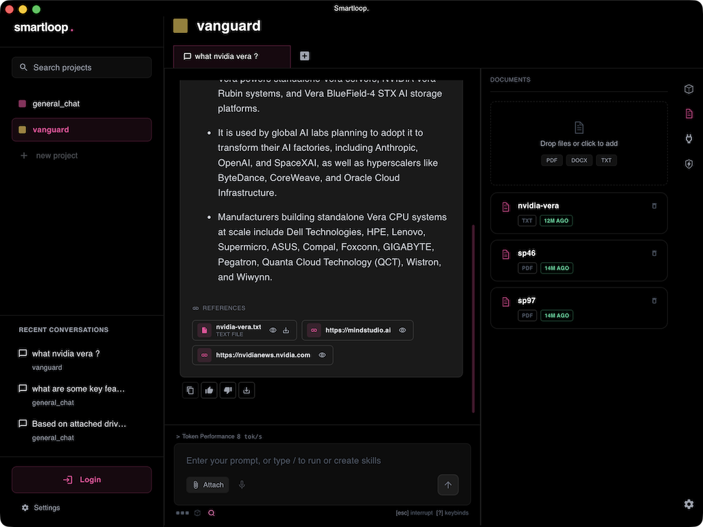
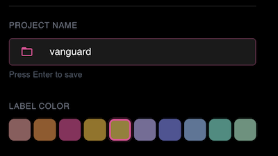

# Bring your documents

Enrich your project with your personal documents to make it more context aware

## Documents panel

Open the **Documents** panel from the right sidebar, then drop files onto it or click to pick them.

Each file appears in the list as soon as it is added and shows its status while it is being read — **INDEXING** until the contents have been processed, after which it is available to the assistant. Large PDFs take a little longer.

### Supported file types

| Type | Formats |
|------|---------|
| Documents | PDF, Word (`.docx`), PowerPoint (`.pptx`), Excel (`.xlsx`) |
| Text | plain text (`.txt`), markdown (`.md`), HTML |

Documents, spreadsheets, slides, and HTML are converted to markdown as they are read. Images go through the vision model, so a scan or a screenshot of a page works the same way a text file does.

## Opening the project folder

Every project also has a folder on your machine. Open the project's settings with the gear (⚙️) icon in the right sidebar, then click the folder icon beside the project name to open it.

Anything you put in that folder is picked up by the project too, which is useful when you want to add a batch of files at once or script the setup.

## Asking about your documents

Once a document is in the project, ask about it directly — as with the `nvidia-vera.txt` file in the screenshot above.

The **REFERENCES** block beneath each answer shows which sources were used, so you can see that the answer came from your files rather than from the model's own knowledge. Each entry can be opened or downloaded.

Ask follow-up questions and the assistant keeps working from the same documents — and if [web search](./web-search.md) is on for the project, it can combine your files with current information from the web in a single answer.
