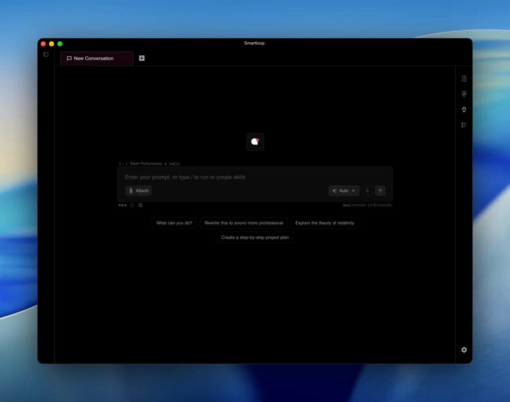
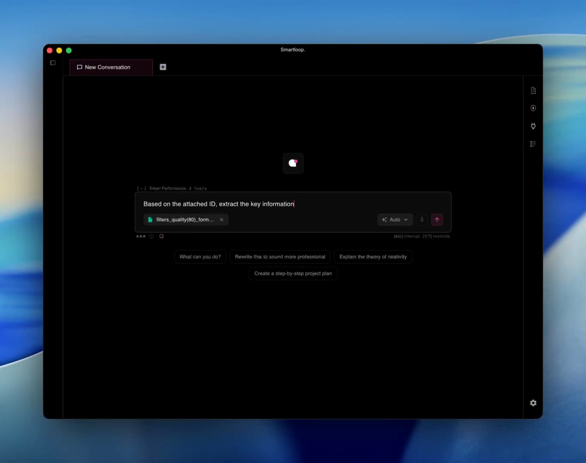
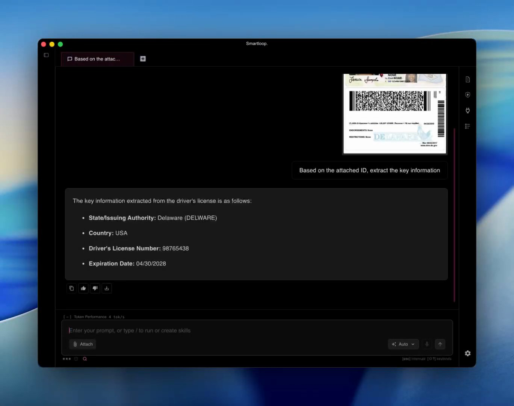
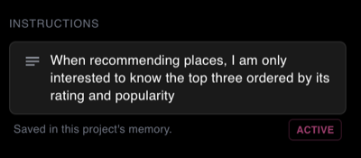
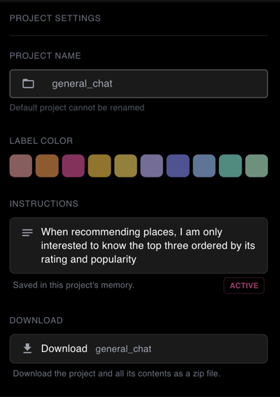
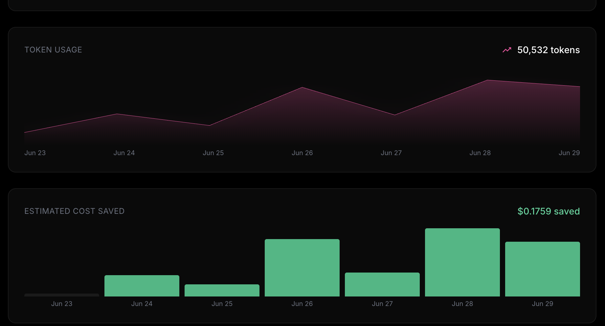

# Getting Started

This document covers how to install the studio app and key concepts to make the most out of it. In order to create a project, you will need to create an account, and the login flow will guide you through the process


## First look

Download [Smartloop Studio](https://www.smartloop.ai/download/) for macOS, Linux, or Windows, then open the app.

On first launch, Smartloop Studio completes its initial setup. This can take a few minutes, depending on your configuration.

When setup is complete, you can start using the app immediately. The app then displays the prompt window shown below.



* **Conversation tabs** run along the top; the **+** opens a new one.
* **The prompt box** takes your question. **Attach** adds a file, and **Auto** opens the model selector.
* **Starter prompts** beneath it are a quick way to try the app.
* **The icons on the right** open the side panels: documents, skills, connections, and the activity log.


By default, Smartloop Studio includes `sl-mini`, its base model. To select additional models, press `Ctrl+Shift+M` or click the `auto` button to open the model window. You can select one or more of the available free models, which are curated for vision, document processing, and skills. Smartloop Studio also considers your available system resources when selecting models.

:::tip Recommended models
For the best combination, enable **Qwen 3.5** (`qwen3.5-2b`) and **Ministral 3** (`ministral3-3b`). Between them they cover general chat, reasoning, document processing, and vision, giving orchestration a strong model for each step of a request.
:::


:::info Best Performance
Smartloop Studio needs an **Apple Silicon Mac (M3 or newer) with 16 GB of unified memory**, or a **Windows 11 / Linux x86_64 machine with 16 GB of system RAM and a Vulkan-capable GPU** — NVIDIA, AMD, or Intel, including integrated graphics. GPU acceleration runs through Vulkan (Metal on macOS), and the runtime is bundled — you don't need to install the Vulkan SDK on your machine.

More memory is better: 24 GB or above gives orchestration room to select larger models.

Larger GPUs allow orchestration to select larger models for better task quality and performance, instead of defaulting to smaller models such as a 1B parameter model.
:::


## Creating Project

A project is your workspace for documents, skills, and connected tools. Use it to collect information, extract insights, and tailor Smartloop Studio to your work. Within a project, you can:

* [Add personal documents](#adding-documents)
* [Create skills](/docs/skills)
* [Connect external services](/docs/mcp-servers), such as Notion and Linear

To create a project, select `+ New Project` in the left navigation bar. This opens the project creation dialog.


Enter a name and choose a color for your project. You can also import a project that you previously downloaded from Project Settings.

## Adding Documents

Bring up document section using `ctrl+shift+D` or click on the document icon on the right planel:

You can add documents of the following format:

* PDF 
* DOC 
* TXT 

OCR documents require vision capabilities and Smartloop v1.0.57+. Follow the orchestration documentation to understand how model selection works.


Below is an annotation of various key functionality of the app


## Attachments

Attachments are context documents, such as invoices, receipts, or ID cards, that you can quickly summarize or reference in a conversation. They are available only within the conversation where you attach them.

Click **Attach** in the prompt box, choose a file, and ask about it:



The answer is drawn from the file itself. Here a vision model reads the ID card and pulls out its key fields:




## Project Instructions

Add project-wide instructions to control the format and style of responses. For example, you can instruct Smartloop Studio to recommend no more than three places to visit. These instructions apply to every conversation in the project.



Open Project Settings by pressing `Ctrl+Shift+,` or by clicking the gear icon in the right panel.


## Downloading a Project

You can download a project and all its content. To do so, open the project settings by clicking the settings icon, then click the **Download** button. This will package the project — including its documents and skills — into a zip file that you can send to others. The recipient can then import it as a new project template.




## Monitoring

:::note Monitoring Logs
Once the app is installed, logs can be found at `~/.smartloop/server.log`. On macOS or Linux-based systems, you can view the logs with:

```bash
less ~/.smartloop/server.log
```

These logs provide information about whether the agent selected the expected model and whether it could not process a user prompt due to GPU limitations.
:::


Once you are logged in, each prompt you send uses tokens. The token count is reported to the console, which is used to render the dashboard that includes the tokens consumed over the last seven days and cost saved.



We use the following API to report token usage:
https://api.smartloop.ai/redoc#tag/usage

None of your content or data is sent, since we use this product ourselves and we deeply value your privacy.


## Installing on Linux

Smartloop Studio ships through the [Snap Store](https://snapcraft.io/smartloop-studio), which installs the app and keeps it up to date across distributions. If you have `snapd` installed, you can install it from the terminal:

```bash
sudo snap install smartloop-studio
```

Or install it directly from the [Snap Store listing](https://snapcraft.io/smartloop-studio).
