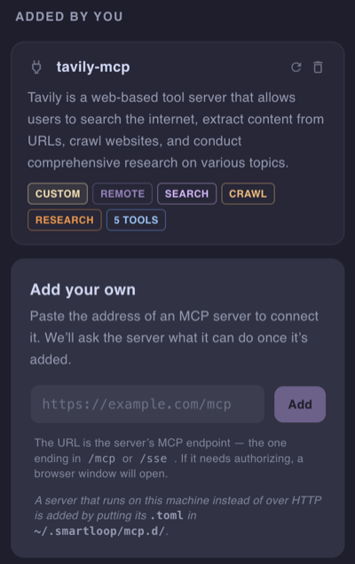

# Connections

Connections let your assistant work with tools and data beyond this app. Connecting one gives it new capabilities through a [Model Context Protocol (MCP)](https://github.com/modelcontextprotocol) server — so it can search a wiki, file a ticket, or read a board on your behalf, using your own account.

Connections belong to a project, not to the app. Each project decides what it can reach, so a work project and a personal one need not share the same services.

## Getting started

Open a project and click the plug icon in the right-hand rail to open the **Connections** panel. The keyboard shortcut is **⌘⇧C** on macOS, **Ctrl+Shift+C** elsewhere.

The panel lists a curated catalog of services first, then anything you have added yourself under **Added by you**.

## Connecting a service from the catalog

The catalog covers services that work out of the box:

| Service | What it reaches |
|---|---|
| Notion | Pages, databases, and wiki content |
| Linear | Issues and project tracking |
| Trello | Boards, cards, and tasks |
| monday.com | Boards and workflows |
| Canva | Designs, graphics, and assets |

Click a card to connect it. Your browser opens so you can sign in to that service and approve access, then hands control back to Studio. Nothing is typed into Smartloop — authorization happens on the service's own site.

While authorization is pending, the card shows **Authorizing** and the spinner doubles as a cancel button, so an approval you decide against can be backed out of.

Once connected, the card shows which account it is linked as — useful when you have more than one Notion or Linear login. Click the link icon in the corner of a card to disconnect it.

The catalog is served from Smartloop rather than baked into the app, so new services can appear without an app update.

## Adding your own

Any MCP server reachable over HTTP can be added by pasting its address into the **Add your own** card at the bottom of the panel and clicking **Add**.



The address is the server's MCP endpoint — usually the one ending in `/mcp` or `/sse`. For example, to add [Tavily](https://tavily.com) for web search and crawling, paste its endpoint with your API key:

```
https://mcp.tavily.com/mcp/?tavilyApiKey=<your-api-key>
```

Once it is added, Studio asks the server what it can do. The new card appears under **Added by you** with a description and tags drawn from the server's tools, a **Remote** tag, and a count of the tools it offers. If the server needs authorizing, a browser window opens so you can sign in and approve access, as with a catalog service.

Use the refresh button on the card to re-index it, or the trash button to remove it.

## Seeing what a connection can do

Click a connected card, or its tool-count pill, to see every tool the server offers, along with the parameters each one takes and which are required.

Each tool has a copy button that yields its reference name in `connection.tool` form — `notion.notion-search`, for example. That is the name a skill uses to refer to it.

## Keeping a connection current

A connection picks up its tools when you connect it. If you change what it's allowed to do on the service's own site, or the service adds something new, use the refresh button on the card — **Re-index this connection** — to pick up the change.

The pill on each card shows where that stands: **Queued**, **Indexing**, **Indexed** (which becomes a relative timestamp such as "2h ago" once it has completed), or **Failed**, with the error in its tooltip.

## How it works

1. **Your prompt decides which connection is used.** Every connected service offers a set of tools, and the assistant is given their names, what each one does, and the arguments each one requires.
2. **It picks the tool that matches and fills in the arguments from your prompt** — the search phrase, the page title, the issue description. Optional arguments are left out, so nothing is invented that you did not ask for.
3. **The call is made to the service using your account**, and you see it in the conversation as it happens:

   ```
   Calling notion.notion-search(query='pitch deck')
   ```

4. **The answer is written from what came back.** When a tool returns a list, the records behind it are fetched too, so the answer reflects their contents rather than just their titles.

## Summary

Connections are how a project reaches past your own documents — a service from the catalog in one click, or any other by pasting its URL. Once connected, the assistant works out on its own which tool a question needs.
