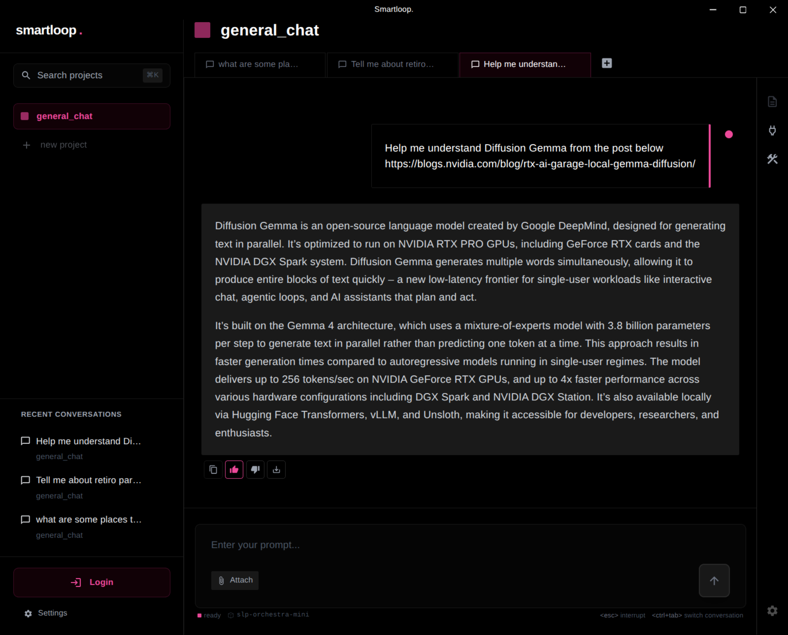

# Personalizing your Project

The model keeps a memory of useful context from your conversations, so you don't have to provide the same information again. You control what goes into that memory through a simple feedback loop: give a **thumbs up** or **thumbs down** on any response the model generates.

For example, if you ask the model to summarize an article from a blog post, you can tell it to remember the summary within the project scope by clicking the thumbs up icon on that response.

This stores the information into memory. The next time you ask a question about `Diffusion Gemma` from a difference conversation, the model can answer without fetching the blog post again from the memory

Curating memory this way makes results more predictable — responses reflect your style and the information you've chosen to keep, which leads to better generation of new content and personalization of your project

Giving a thumbs down does the opposite: it removes the information from the model's context.
