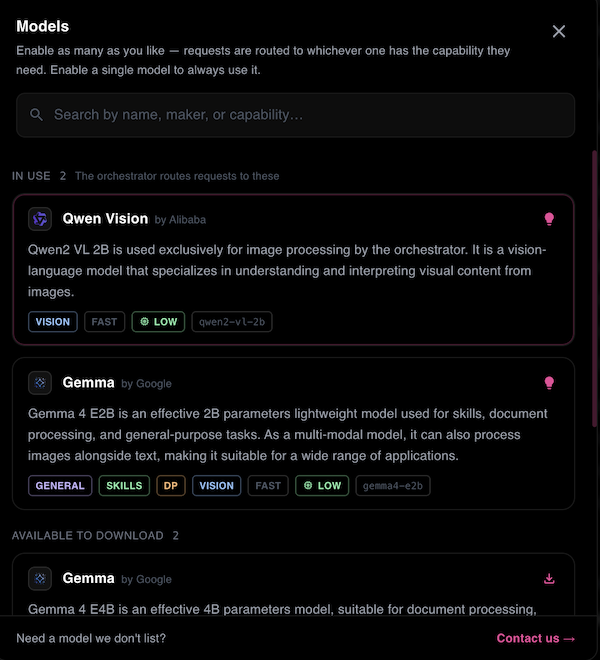

import ThemedImage from '@theme/ThemedImage';
import useBaseUrl from '@docusaurus/useBaseUrl';

# Model Orchestration

Smartloop runs several small models rather than one large one, and picks the right one for each step of a request. You don't choose between a vision model, a reasoning model, or a general one — the orchestrator does, based on what the task needs and what your machine can run.

## Auto Mode

**Auto Mode chooses the right models for every task**, so you can focus on the work instead of model settings. It is what lets a single prompt read an image, search the web, and look through your documents in one go.

<ThemedImage
  alt="A prompt goes to the sl-mini orchestrator, which runs vision, tool, and document steps; a response model writes the answer, and the orchestrator validates each step and re-plans if needed"
  sources={{
    light: useBaseUrl('/img/orchestration-flow-latte.svg'),
    dark: useBaseUrl('/img/orchestration-flow-mocha.svg'),
  }}
/>

For every request, Auto Mode weighs three things:

* **The capabilities each step needs** — vision for an image, reasoning for a multi-step question, document processing for your files.
* **The resources your machine has free** — a model is only chosen if it fits in the memory available right now.
* **The workload** — how much there is to read and produce.

When you enable a single model, every step uses that model. Enable several and Auto Mode routes between them — the steps below show how.

## How it works

1. **The orchestrator plans the request.** `sl-mini`, the orchestration model, works out which capabilities your prompt needs — reading an image, searching the web, looking through your documents — and which tools and models to use for each.
2. **Each step runs on the model suited to it.** An image goes to a vision model, a question about current events to [web search](./web-search.md) or a [connection](./mcp-servers.md), and a question about your files to the project's document index.
3. **The answer is written by the model best placed to write it**, using everything the earlier steps produced.
4. **Each step is validated as it runs**, and the plan is adjusted if a step doesn't deliver what the next one needs.

## Choosing models

Open the model selector with `Ctrl+Shift+M`, or click **Auto** in the prompt box, and enable the models you want Auto Mode to choose from.

## Example: reading an ID card

With the models above enabled, attach a photo of an ID card and ask for its key details. The request moves through the models like this:

| Time | Stage | What happens |
|------|-------|--------------|
| `0.00s` | Prompt received | Smartloop receives the request, and the attached image is prepared. |
| `0.04s – 7.41s` | Image processing | `qwen2-vl-2b` reads the image and extracts what it can see. |
| `7.41s – 9.79s` | Task planning | `sl-mini` plans the response, selects tools, and loads the vision model. |
| `9.79s – 12.73s` | Vision analysis | `gemma4-e2b` examines the image for the details that were asked for. |
| `12.73s – 14.93s` | Response | The selected model writes the answer. |
| `14.93s` | Answer delivered | The key details are returned. |

The specialized vision model does the reading first; the orchestrator then hands its output to the model best able to analyze it and answer.

:::tip
Open the orchestration log with `Ctrl+Shift+L` to see each step of a request, which model handled it, and how long it took.
:::

## Models

Models generally run with `Q4_K_M` quantization, which keeps them small enough for everyday hardware with little loss in quality. We will adopt better compression methods as they become available and stable.

The set of models grows as new use cases come up — to see which ones your machine has, [ask the local agent](./local-ai.md#available-models). To request a model, contact us at support@smartloop.ai.

## Memory management

Which models can run depends on the memory available, so the orchestrator weighs that alongside the task: unified memory on Apple Silicon, VRAM on a dedicated GPU. Through Vulkan, Smartloop can also use the integrated GPU memory of many modern Intel and AMD processors when there is no dedicated GPU.

On a machine with limited memory, enabling fewer or smaller models helps keep every step within what the device can run reliably. See [Local AI](./local-ai.md#hardware) for supported hardware.
