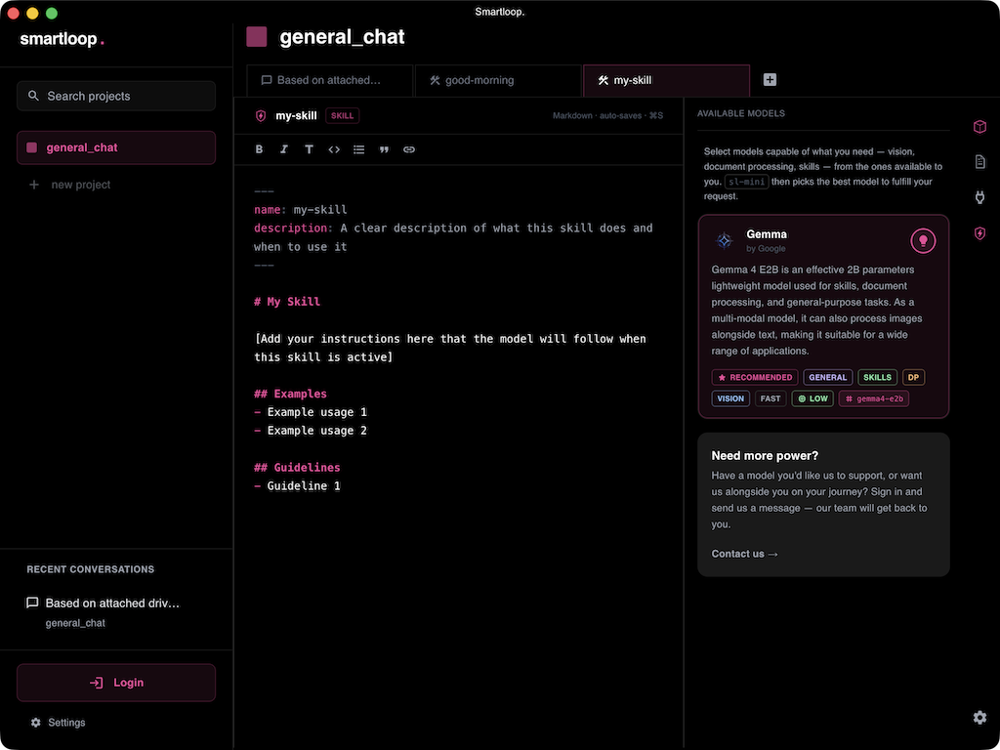

# Skills

## Get Started

Pack your repetitive prompts into skills. You can create agent skills to analyze documents, search the web, and generate consolidated reports — all in one go.

Here is a skill example that recommends a 10-minute workout routine based on the current day of the week:

````markdown
---
name: good-morning
description: When the user says "good morning", run this skill to recommend a 10-minute workout routine based on the current day of the week
---

# Good Morning
Recommend a 10-minute workout routine. Exercises should primarily use a dumbbell or bodyweight movements.

## Guidelines
- Base your response on the current day of the week
- For weekends, recommend a lighter workout
- For the first half of the week, focus on upper-body workouts; for the second half, focus on lower-body
- Do not repeat the same workout when called multiple times

````

You can execute a skill by using a slash (/) command directly from your input prompt, or create a new one — this will open a template you can use to craft your own.




## Guidelines for Skills

Provide as much detail as possible when crafting a skill. Identify the prompts and steps you repeat regularly and package them into a well-defined, executable skill.


## Summary

Agent skills are the blueprint of your project. They define how you want to perform tasks, extract information, or build a foundational AI workflow that you can extend with APIs to automate your processes.