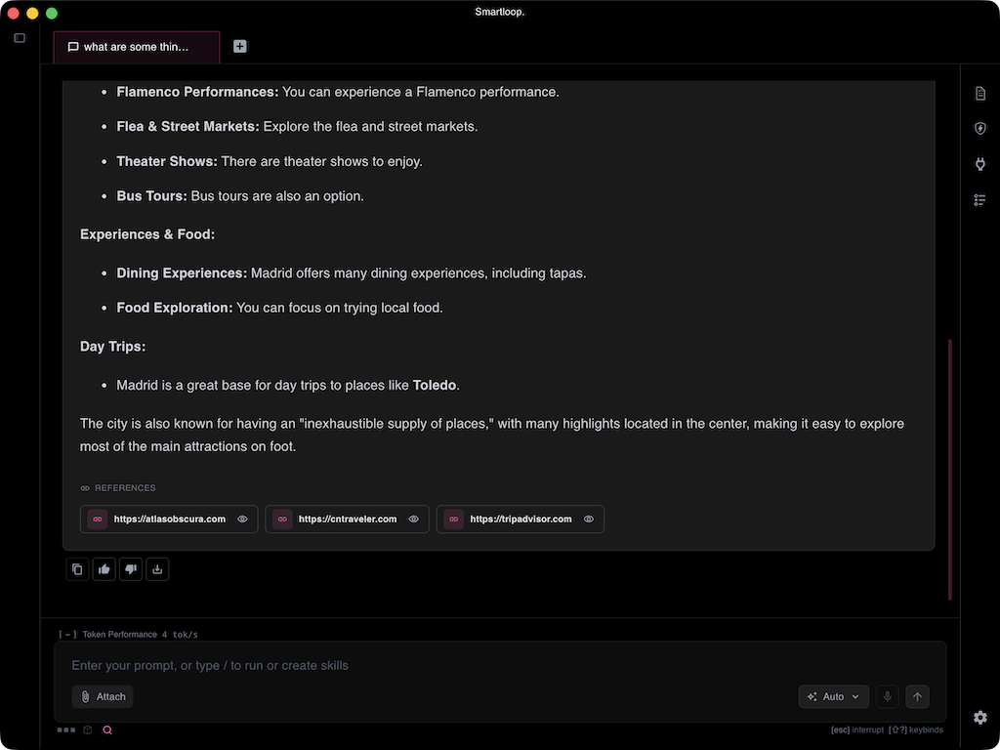
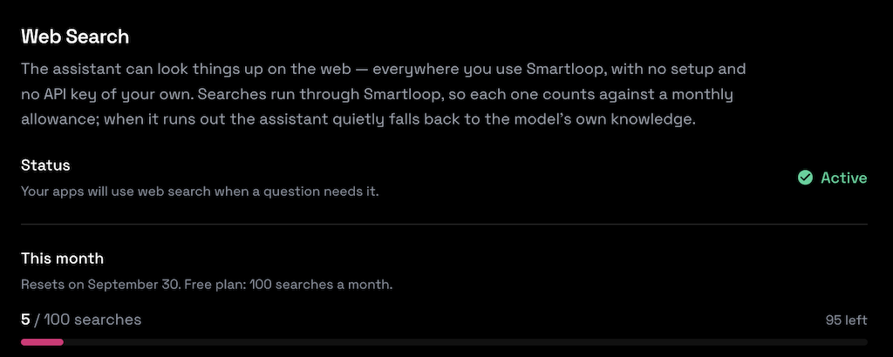

# Web Search

AI search lets a project reach current information from the web, so answers reflect the latest data rather than only the model's training data and the documents you have indexed locally. Search in Smartloop is hybrid: the web is used only to find pages relevant to your question, and everything else — reading your prompt and attachments, ranking the pages, and writing the answer — runs on local models on your device. Every answer that used search is annotated with the sites it drew from.

## Getting Started

There is nothing to set up and no API key to sign up for. Searches are proxied through Smartloop, so web search works as soon as you are signed in — on every device, with no per-machine configuration.

:::info What it costs
Search is the one metered part of Smartloop: every account gets a monthly allowance of searches, and you can buy more from your [dashboard](https://app.smartloop.ai/settings/websearch/). Everything else — the models, your documents, tools and skills — stays free and runs on your machine. See [Pricing](https://smartloop.ai/pricing) for details.
:::

## Hybrid search

In a fully cloud AI search product, your prompt, any attachments, and the surrounding context are sent to a hosted model, which searches, reads the results, and writes the answer on the provider's servers. Smartloop splits that work: the only thing that goes out is the search query, and the heavy lifting stays on your machine.

| Step | Where it runs |
| --- | --- |
| Reading your prompt and any attached image or document | On your device |
| Deciding which tools the question needs | On your device |
| Finding result links for the query | Smartloop's search endpoint — the query only |
| Fetching and ranking the candidate pages | On your device |
| Writing the answer from the top sources | On your device |

The local steps are not one large model doing everything. Each sub-task is assigned to a model suited to it — a vision model reads an attached photo, a small model picks the tools, and another writes the response — which is how the whole flow fits on an ordinary laptop. See [Model orchestration](./model-orchestration.md) for how models are chosen.

For example, attach a photo of a device and ask where to buy it and what it costs. The photo is understood on your device, a query goes out, the most relevant store and review pages are read locally, and the answer comes back with those pages listed as references. The photo itself never leaves your machine.

## Combining your data

Search is most useful alongside your own data rather than instead of it. Because a project already holds your documents, one prompt can draw on both — your documents for context, the web for what is current.

Product research is a good example. With your existing gear, specifications, or past purchases in the project, you can ask what to buy next: the assistant reads your documents to understand what you already own and what would fit, searches for current models, pricing, and reviews, and then recommends one — with the sites behind the recommendation listed underneath.

## Annotated sources

When an answer draws on search results, the sources used are listed in a **REFERENCES** block beneath it. Web sources link out to the original page, so you can confirm where a claim came from and read further. Documents from your own project appear in the same block, labelled by file type and openable directly — so it is clear at a glance which parts of an answer came from your files and which came from the web.

## How it works

1. Local models read your prompt and any attachments — an image goes to a vision model — and decide whether the question needs search.
2. Your prompt is normalized into a search query — conversational filler such as "can you tell me" is stripped so the query matches the actual subject rather than the phrasing.
3. The query goes to Smartloop's search endpoint, which returns result links. This is the only step that leaves your machine.
4. Up to ten candidate pages are fetched and converted to text on your device (HTML and PDF are both handled).
5. The candidates are re-ranked by relevance to your question, and the top three are kept as sources for the answer.
6. A local model writes the answer from those sources and lists them under **REFERENCES**.

If search is unavailable for any reason — turned off for the project, this month's allowance used up, or no results — it is skipped silently and the model answers from what it already knows. You will see an answer without a REFERENCES block rather than an error.

## Search while coding

In [Docent](./coding.md), web search is a tool the agent reaches for while writing code, not a separate mode. A coding turn sends the agent your project's files and asks it to answer from them, with the web for what they don't tell: a library's current API, a new flag on a CLI, a breaking change in the latest release, an error message it hasn't seen. The orchestrator decides per turn whether a search is worth it, the same way it does for any other question, so a change that only touches your own code doesn't spend one.

Only the search query leaves your machine. Your source files, the prompt Docent builds from them and the pages that come back stay local; the pages are fetched and ranked on your device and the answer is written by a local model. When a reply drew on the web, its sources are listed under it as references, next to any project documents it used, so you can check the docs the code was written against.

In the terminal:

| Key or command | Action |
|---|---|
| Ctrl+S | Turn web search on or off for the project |
| `/usage` | Searches left this month, with your plan and reset date |
| `/upgrade` | The Pro plan: 1,000 web searches a month |
| `/login` | Sign in, which web search needs |

While a reply runs, the status line above the prompt shows each search step (searching, reading a page) and for how long. Once you've used 70% of the month's searches, the footer under the prompt says how many are left.

## Privacy

Search is the one part of Smartloop that reaches off your machine, and only the query leaves it. You can turn off search from Project Settings.

Smartloop does not keep the query. Your account records only that a search ran — when, from which app, and how many results came back — so you can spot use you do not recognize in your own activity log. The wording, the results, and the pages behind them are never stored. The candidate pages are fetched and ranked on your device, so the sites you end up reading are not something we see either.

The only number we keep is the count itself, which is what the monthly allowance is measured against.

## Checking your usage

Web search is on by default. You can see whether it is active, how many of your month's searches you have used, and when the count resets at [app.smartloop.ai/settings/websearch](https://app.smartloop.ai/settings/websearch/).

Within a project, the toggle under the prompt (⌘⌥S, or Ctrl+Alt+S) turns search on and off for that project.

## Summary

AI search in Smartloop is hybrid: the web supplies fresh, relevant pages, and local models do the rest — understanding your prompt and attachments, ranking the pages, and writing the answer. Your models, documents, and attachments stay on your device, and only the search query leaves it. The annotated references make it clear which parts of an answer came from the web.
